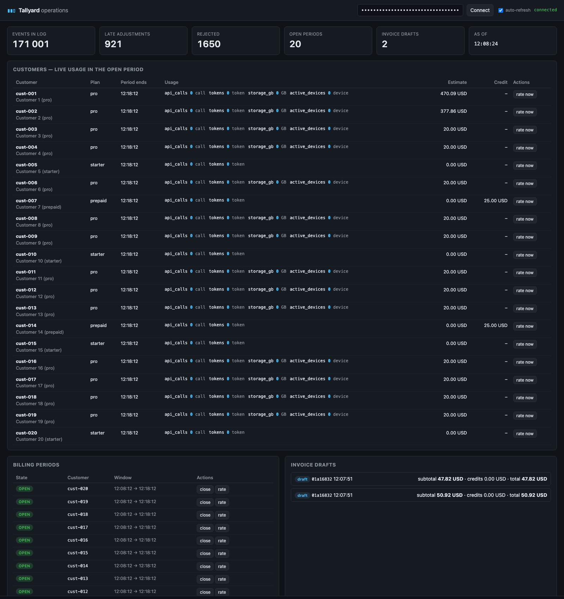
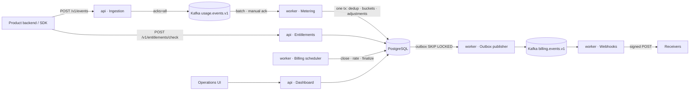
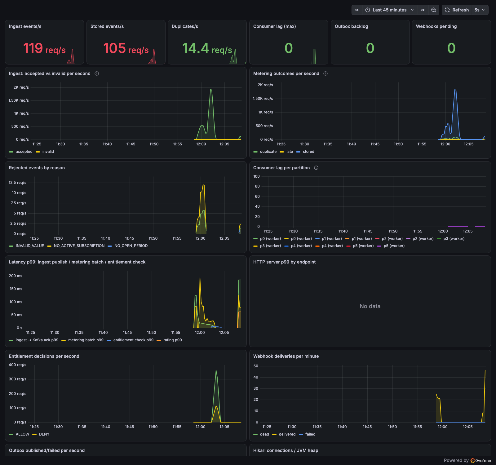

# Tallyard

**Billing-grade usage metering that counts exactly once.**

Tallyard ingests high-volume usage events from software products, counts them exactly once despite
client retries, Kafka redelivery, late arrivals and worker crashes, rates them against pricing plans
with a deterministic engine, enforces real-time entitlements, and produces auditable invoice drafts
that can be reproduced byte-for-byte by replaying the raw event log.

Java 21 · Spring Boot 4.1 · Spring Modulith · PostgreSQL 17 · Apache Kafka 4.1 · Testcontainers ·
OpenTelemetry · Prometheus/Grafana

[](https://github.com/anniigr/tallyard/actions/workflows/ci.yml)


---

## The problem

Any product that charges per unit — API calls, tokens, gigabytes, seats — must answer three questions
correctly and continuously:

1. **How much did customer X use in period P?** The same answer no matter how often an event was
   retried, how late it arrived, or how many times the processing service crashed.
2. **What does that cost under X's plan?** Deterministic, explainable, reproducible months later.
3. **May X consume one more unit right now?** In milliseconds, without drifting far from the ledger.

Teams start with a `usage` table and a cron job, then meet duplicates from SDK retries, late events
from offline clients, invoices nobody can explain, and prepaid balances that go negative under
concurrency. Commercial products (Stripe Billing Meters, Orb, Metronome) and Go/Ruby open-source
projects (OpenMeter, Lago) solve this. There was no modern open-source Java implementation.

## Demonstration



Measured on a laptop (Apple M3, Docker Desktop) — details and raw outputs in
[docs/performance](docs/performance/README.md):

| Scenario | Result |
|---|---|
| Simulator: 500 events/s for 90 s with 5 % duplicates, 2 % late, 1 % invalid; **worker killed at t+25 s, restarted at t+45 s** | 49,104 events accepted, 0 errors; lag peaked at 4,142 and drained in seconds; **all 20 customers' totals matched the simulator's expected totals exactly** |
| k6 ingest, 2,000 events/s for 60 s | 125,967 events accepted, 0 failures, HTTP p50 10 ms / p99 22.8 ms; a single worker counted the full load |
| k6 entitlement checks, 500 req/s for 60 s | 0 failures, p50 0.27 ms / p99 6.05 ms |
| Test suite (`mvn verify`) | 41 unit/property/architecture tests + 36 integration tests on real PostgreSQL and Kafka, all passing in 48 s |

```
=== Truth check (waiting for the consumer to drain) ===
ALL 20 CUSTOMERS MATCH: Tallyard's live totals equal the simulator's expected totals exactly.
```

## Key capabilities

- **Idempotent ingestion** — `POST /v1/events` accepts batches of up to 1,000 events with client
  idempotency keys; 202 is returned only after Kafka acknowledged every record (`acks=all`).
- **Effectively-once counting** — one database transaction per consumed batch; deduplication by a
  unique key with `INSERT … ON CONFLICT DO NOTHING RETURNING`; offsets acknowledged after commit.
- **Six aggregations** — SUM, COUNT, MIN, MAX, LAST, UNIQUE_COUNT over hourly buckets per
  (period, meter, customer).
- **Period lifecycle** — `OPEN → CLOSING → RATED → FINALIZED` with a `FOR SHARE`/`FOR UPDATE` lock
  protocol between counting and settlement; late events become adjustments on the open period.
- **Deterministic rating** — graduated, volume, per-unit, package and flat pricing, included units,
  minimum commitments, prepaid credits consumed in expiry/priority order under row locks and a check
  constraint. Every line carries a tier-by-tier breakdown; every invoice carries a reproducibility
  hash.
- **Replay proof** — `POST /v1/periods/{id}/replay` recomputes a rated period from the immutable
  event log as of the rating time and reports whether it matches.
- **Entitlements** — allow/deny decisions with usage, limit, remaining and estimated remaining credit,
  from a snapshot cache with an explicit staleness bound.
- **Outbox and webhooks** — transactional outbox → `billing.events.v1` → durable, HMAC-signed
  webhook deliveries with exponential backoff, dead-lettering, circuit breaker and manual retry.
- **Multi-tenant security** — hashed API keys with scopes (`INGEST`, `READ`, `ADMIN`), tenant
  isolation on every query, per-key rate limiting, AES-GCM-encrypted webhook secrets.
- **Operations** — health/readiness probes (including a Kafka contributor), Prometheus metrics,
  OpenTelemetry traces through Kafka, a provisioned Grafana dashboard, runbooks, one-command stack.

## Architecture

One deployable, two runtime roles (`api`, `worker`), one PostgreSQL database as the system of record,
Kafka where asynchrony is genuinely needed. Module boundaries are verified at build time by Spring
Modulith; the full set of diagrams (C4 context/containers/components, data and event flow, ERD,
sequences, deployment, failure recovery) is in [docs/architecture](docs/architecture/architecture.md).



Modules: `tenancy`, `catalog`, `ingestion`, `metering`, `billing`, `credits`, `entitlements`,
`outbox`, `webhooks`, `dashboard`, `demo`, plus `shared`. The only inversion — billing defines the
`UsageSource` SPI that metering implements — is what keeps the package graph acyclic.

## Engineering highlights

| Challenge | Mechanism | Where |
|---|---|---|
| Count exactly once under retries, redelivery, crashes | Unique `(tenant_id, event_id)`; multi-row insert-returning; ack after commit | `metering/internal/UsageEventStore`, `MeteringService`, `UsageEventConsumer`; `ConsumerRedeliveryIT`; [ADR-002](docs/architecture/adr/ADR-002-effectively-once-accounting.md) |
| Never write usage into a settled period | `FOR SHARE` (metering) vs `FOR UPDATE` (rating) on the period row; `@Version`; partial unique index for "one OPEN period" | `billing/internal/BillingRepositories`, `BillingService`; [ADR-003](docs/architecture/adr/ADR-003-period-lifecycle-and-late-events.md) |
| Late events after an invoice exists | Adjustments carried into the open period, priced marginally; buckets frozen; replay as-of rating time | `MeteringService.count`, `RatingEngine.rate` |
| Exactly one invoice per period with concurrent schedulers | `FOR UPDATE SKIP LOCKED` work queue + optimistic version + unique invoice per period | `BillingScheduler`, `BillingLifecycleIT.concurrentRating…` |
| Provable invoices | Pure `RatingEngine` (no clock, no I/O — enforced by ArchUnit), tier breakdowns, SHA-256 hash, log replay | `billing/internal/RatingEngine`, `RatingEnginePropertyTest`; [ADR-004](docs/architecture/adr/ADR-004-deterministic-rating-and-replay.md) |
| Prepaid balance never negative | Grants locked in deterministic order; `CHECK (amount_consumed <= amount_granted)` | `credits/internal/CreditService`; `CreditLedgerConcurrencyIT` |
| Fast allow/deny | Snapshot cache with a documented 2 s staleness bound | `entitlements/internal/EntitlementService`; [ADR-005](docs/architecture/adr/ADR-005-entitlement-staleness.md) |
| Reliable fan-out | Transactional outbox (`Propagation.MANDATORY`), `SKIP LOCKED` publisher, idempotent consumers, signed webhooks with backoff/DLQ/breaker | `outbox/internal/OutboxPublisher`, `webhooks/internal/WebhookDispatcher`; [ADR-006](docs/architecture/adr/ADR-006-transactional-outbox-and-webhooks.md) |
| Poison messages | Per-record dead-letter topic with reason headers; whole batches are never dropped | `UsageEventConsumer`; `IngestApiIT.unparseableKafkaRecords…` |
| Hot path performance | JDBC with set-oriented SQL, pre-aggregated bucket deltas, UUIDv7 keys, short-TTL caches | [ADR-007](docs/architecture/adr/ADR-007-jdbc-on-the-hot-path.md), [docs/performance](docs/performance/README.md) |

## Event-driven processing

Two topics, both with explicit contracts:

| Topic | Key | Contract | Semantics |
|---|---|---|---|
| `usage.events.v1` | `tenantId:subject` | [`usage-event.v1.schema.json`](tallyard-app/src/main/resources/schemas/usage-event.v1.schema.json) + `ty-schema-version` header | At-least-once; ordered per customer |
| `usage.events.v1.dlt` | original | original payload + `ty-dlt-reason`/`ty-dlt-source` | Unparseable records only |
| `billing.events.v1` | aggregate id | `OutboxMessage` envelope | At-least-once; ordered per aggregate; consumers dedupe on event id |

The consumer is a batch listener with manual acknowledgement. A batch is one PostgreSQL transaction
(dedup insert → period lock → bucket upserts → adjustments → rejections); offsets are acknowledged
after the commit. Infrastructure failures retry the whole batch with exponential backoff forever;
malformed records are dead-lettered individually.

## Consistency and reliability guarantees

Stated precisely in [docs/architecture/failure-model.md](docs/architecture/failure-model.md). In short:

- **Claimed**: every accepted event is counted exactly once in the database given stable event ids
  (at-least-once delivery + idempotent transactional write = effectively-once); 202 means durable;
  usage never lands in a settled period; one invoice per period; invoices reproducible from raw
  events; prepaid balances never negative; outbox events published at least once, in order per
  aggregate; tenant isolation.
- **Not claimed**: exactly-once Kafka semantics; dedup of events whose client generated a new id on
  retry; read-your-writes for entitlements (bounded staleness instead); multi-region operation.

## API

OpenAPI 3.1 is generated from code (`/v3/api-docs`, Swagger UI at `/swagger-ui.html`) and
snapshotted in [docs/api/openapi.json](docs/api/openapi.json); `ContractIT` fails when the API drifts.

| Area | Endpoints |
|---|---|
| Ingestion | `POST /v1/events` |
| Catalog | `POST/GET /v1/meters`, `/v1/customers`, `/v1/plans`, `/v1/subscriptions`, `POST /v1/subscriptions/{id}/end` |
| Usage | `GET /v1/periods/{id}/usage`, `/adjustments`, `GET /v1/rejections`, `GET /v1/usage/stats` |
| Billing | `GET /v1/periods`, `GET /v1/periods/{id}`, `/estimate`, `/invoice`, `POST …/close`, `/rate`, `/finalize`, `/replay`, `GET /v1/invoices` |
| Credits | `POST /v1/credits`, `GET /v1/customers/{externalId}/credits` |
| Entitlements | `POST /v1/entitlements/check` |
| Webhooks | `POST/GET/DELETE /v1/webhooks`, `GET /v1/webhooks/deliveries`, `POST …/deliveries/{id}/retry` |
| Tenancy | `POST /v1/admin/tenants` (bootstrap token), `POST/GET/DELETE /v1/api-keys` |
| Dashboard | `GET /v1/dashboard/overview` |

Authentication: `X-Api-Key: ty_…` (or `Authorization: Bearer`). Errors are RFC 9457 problem details
with a stable `code` extension.

## Data model

PostgreSQL schema in [`V1__core_schema.sql`](tallyard-app/src/main/resources/db/migration/V1__core_schema.sql)
(Flyway; Hibernate validates, never generates). Core tables: `usage_event` (immutable log, unique
`(tenant_id, event_id)`), `meter_bucket` (hourly aggregates per period/meter/customer),
`billing_period` (state machine, optimistic version), `invoice_draft`/`invoice_line`,
`usage_adjustment`, `rejected_event`, `credit_grant`/`credit_ledger_entry`, `outbox_event`,
`webhook_endpoint`/`webhook_delivery`, catalog tables. ERD in the architecture document.

## Quick start

Requirements: Docker Desktop (or Docker Engine + Compose v2), `make`, and for development JDK 21 +
Maven 3.9+.

```bash
git clone https://github.com/anniigr/tallyard.git && cd tallyard
make env          # creates .env with a fresh encryption key
make up           # builds the image and starts api, worker, PostgreSQL, Kafka, Prometheus, Grafana, Jaeger
```

Then open:

| | URL | Credentials |
|---|---|---|
| Operations dashboard | http://localhost:8080 | demo key from `.env` (`TALLYARD_DEMO_ADMIN_KEY`) |
| OpenAPI / Swagger UI | http://localhost:8080/swagger-ui.html | – |
| Grafana | http://localhost:3000 | anonymous viewer (admin/admin to edit) |
| Prometheus | http://localhost:9090 | – |
| Jaeger | http://localhost:16686 | – |

The first start seeds a demo tenant: 4 meters, 3 plans (`pro` graduated/volume/package,
`starter` with a hard limit, `prepaid` with credits), 20 customers, 10-minute billing periods and a
webhook pointing at the built-in sink. Generate traffic and verify the totals:

```bash
mvn -q -pl :tallyard-simulator package -DskipTests
make sim RATE=500 DURATION=60
```

Try the failure drill from [docs/testing/failure-scenarios.md](docs/testing/failure-scenarios.md):
kill the worker during the run and watch the truth check still pass.

Ingest an event by hand:

```bash
KEY=$(grep TALLYARD_DEMO_ADMIN_KEY .env | cut -d= -f2)
curl -s -X POST localhost:8080/v1/events -H "X-Api-Key: $KEY" -H 'Content-Type: application/json' -d '{
  "events": [{"eventId": "req-1", "eventType": "request", "subject": "cust-001",
              "occurredAt": "'$(date -u +%Y-%m-%dT%H:%M:%SZ)'", "properties": {"tokens": 1200}}]}'
```

## Configuration

All settings are environment variables with defaults in
[`application.yml`](tallyard-app/src/main/resources/application.yml); the Compose stack reads
[`.env`](.env.example).

| Variable | Purpose | Default |
|---|---|---|
| `TALLYARD_ROLE` | `all`, `api` or `worker` | `all` |
| `TALLYARD_DB_URL` / `_USER` / `_PASSWORD` | PostgreSQL | `jdbc:postgresql://localhost:5432/tallyard` |
| `TALLYARD_KAFKA_BOOTSTRAP` | Kafka bootstrap servers | `localhost:9092` |
| `TALLYARD_ENCRYPTION_KEY` | base64 32 bytes; encrypts webhook secrets (required for webhooks) | – |
| `TALLYARD_BOOTSTRAP_TOKEN` | protects `POST /v1/admin/tenants`; empty disables it | – |
| `TALLYARD_DEMO_ENABLED` / `_ADMIN_KEY` / `_PERIOD_MINUTES` / `_GRACE_SECONDS` | demo tenant seeding | `false` |
| `TALLYARD_INGEST_RATE_LIMIT` | events/s per API key per node | `5000` |
| `TALLYARD_CONSUMER_CONCURRENCY` | Kafka listener threads per worker | `3` |
| `TALLYARD_TOPIC_PARTITIONS` | partitions for new topics | `6` |
| `TALLYARD_OTLP_ENDPOINT` / `TALLYARD_TRACE_SAMPLING` | tracing | `http://localhost:4318/v1/traces` / `1.0` |
| `TALLYARD_LOG_FORMAT` | `ecs`/`logstash` for JSON logs | plain |
| `TALLYARD_PORT` / `TALLYARD_MANAGEMENT_PORT` | HTTP / actuator ports | `8080` / `9091` |

## Testing

```bash
mvn test      # 41 unit, property (jqwik), Spring Modulith and ArchUnit tests (~20 s)
mvn verify    # + 36 integration tests with Testcontainers PostgreSQL 17 and Kafka 4.1 (~50 s)
```

Strategy, layer-by-layer coverage of the acceptance criteria and the deliberately manual drills are
in [docs/testing](docs/testing/testing-strategy.md). Highlights: redelivery after a simulated crash
between commit and ack, concurrent rating, concurrent credit consumption, late events with replay,
poison records to the dead-letter topic, WireMock-driven webhook failure/recovery, contract tests for
the Kafka schema and the OpenAPI document.

## Performance

See [docs/performance](docs/performance/README.md) for environment, commands, raw outputs,
bottleneck analysis and the tuning applied. Headline numbers are in the Demonstration section above.
Nothing is extrapolated; what was not measured is listed.

## Observability

Prometheus metrics (custom counters/timers plus Kafka, Hikari, JVM), OpenTelemetry traces spanning
HTTP → Kafka → consumer → JDBC, structured logs with tenant and trace ids, liveness/readiness with a
Kafka contributor, and a provisioned Grafana dashboard. Metric catalogue and alerting suggestions in
[docs/operations/observability.md](docs/operations/observability.md); runbooks in
[docs/operations/runbooks.md](docs/operations/runbooks.md).



## Security

API keys stored as SHA-256 with scopes; tenant id derived only from the key; Bean Validation and
size/depth limits on all input; parameterised SQL; Flyway-only schema; AES-256-GCM for webhook
secrets; HMAC-SHA256 webhook signatures with timestamps; per-key rate limiting; non-root container;
separate management port; no secrets in the repository (gitleaks in CI). Review with implemented
controls, accepted limitations and follow-ups (webhook SSRF allow-list, vulnerability scanning, key
rotation) in [docs/security/security-review.md](docs/security/security-review.md).

## Architectural trade-offs

- **Modular monolith, not microservices** — the invariants live in one transaction; the module graph
  is verified; API and worker roles still scale independently ([ADR-001](docs/architecture/adr/ADR-001-modular-monolith.md)).
- **Effectively-once, not "exactly-once"** — honest naming for at-least-once delivery plus
  idempotent writes ([ADR-002](docs/architecture/adr/ADR-002-effectively-once-accounting.md)).
- **Adjustments, not re-rating** — invoices stay immutable; late usage is carried forward and priced
  marginally ([ADR-003](docs/architecture/adr/ADR-003-period-lifecycle-and-late-events.md)).
- **Bounded staleness for entitlements** over read-your-writes ([ADR-005](docs/architecture/adr/ADR-005-entitlement-staleness.md)).
- **Hand-rolled outbox** over Spring Modulith's registry, for an explicit guarantee boundary
  ([ADR-006](docs/architecture/adr/ADR-006-transactional-outbox-and-webhooks.md)).
- **JDBC on the hot path, JPA for aggregates** ([ADR-007](docs/architecture/adr/ADR-007-jdbc-on-the-hot-path.md)).
- **No LLM features** — every answer is exact and reproducible ([ADR-008](docs/architecture/adr/ADR-008-no-ai-in-core-path.md)).

Full comparison of selected and rejected technologies:
[docs/architecture/technology-decisions.md](docs/architecture/technology-decisions.md).

## Current limitations

- Single PostgreSQL primary; `usage_event` is not yet partitioned (the path — monthly range
  partitions, then tenant sharding — is documented).
- Entitlement decisions can lag usage by up to the cache TTL; rate limiting is per node.
- `UNIQUE_COUNT` meters cannot absorb late events (rejected with a reason).
- Webhook URLs are not checked against an SSRF allow-list; no dependency/image vulnerability scanner
  in CI; encryption key rotation is not implemented.
- Monthly periods are calendar months in UTC; no per-tenant time zones; one currency per plan.
- The operations UI and the webhook sink are demonstration layers, not product surfaces.
- Measured on a laptop with generators sharing the machine; no multi-worker scaling run.

## Future development

Table partitioning and retention; a deterministic per-meter anomaly detector emitting
`usage.anomaly` events; shared entitlement cache invalidated by the consumer; plan versioning and
mid-period plan changes with proration; credit notes; multi-currency; a client SDK generated from the
OpenAPI document.

## Repository layout

```
tallyard-app/          Spring Boot application (modules under io.tallyard.*), Flyway schema, static UI
tallyard-simulator/    load / chaos / truth-check generator (plain Java)
deploy/                Docker Compose, Dockerfile, Prometheus and Grafana provisioning
loadtest/              k6 scripts
docs/                  research, product, architecture (ADRs), testing, performance, operations,
                       security, interview preparation, api (OpenAPI snapshot), engineering progress
```

## Documentation index

- Research: [job market](docs/research/job-market-analysis.md) · [skills matrix](docs/research/engineering-skills-matrix.md) · [open-source landscape](docs/research/open-source-landscape.md) · [patterns](docs/research/architectural-patterns.md) · [anti-patterns](docs/research/anti-patterns.md) · [concepts](docs/research/15-project-concepts.md) · [selection](docs/research/final-project-selection.md)
- Product: [specification](docs/product/product-specification.md) · [use cases](docs/product/use-cases.md) · [acceptance criteria](docs/product/acceptance-criteria.md)
- Architecture: [overview and diagrams](docs/architecture/architecture.md) · [ADRs](docs/architecture/adr) · [technology decisions](docs/architecture/technology-decisions.md) · [failure model](docs/architecture/failure-model.md)
- Verification: [testing strategy](docs/testing/testing-strategy.md) · [failure scenarios](docs/testing/failure-scenarios.md) · [performance](docs/performance/README.md)
- Operations: [observability](docs/operations/observability.md) · [runbooks](docs/operations/runbooks.md) · [security review](docs/security/security-review.md)
- Interview: [walkthrough](docs/interview/walkthrough.md) · [48 questions and answers](docs/interview/questions-and-answers.md) · [architecture defence](docs/interview/architecture-defense.md) · [ownership checklist](docs/interview/ownership-checklist.md)
- [Engineering progress log](docs/engineering-progress.md)

## License and acknowledgements

MIT — see [LICENSE](LICENSE).

The problem space is well charted by Stripe's Billing Meters documentation, OpenMeter's and Lago's
engineering posts on deduplication and rating, and the transactional-outbox and idempotent-consumer
patterns documented by the Spring Modulith and Debezium projects; the surveyed sources are cited in
`docs/research`. The code in this repository is an original implementation and was developed with an
AI coding assistant under human direction.
