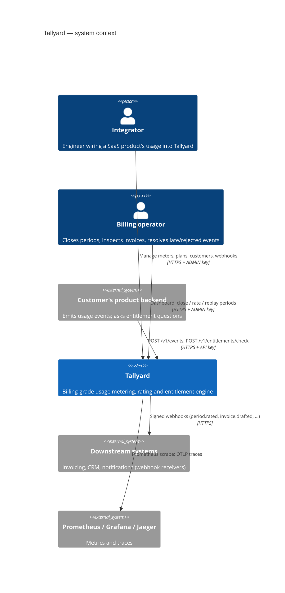
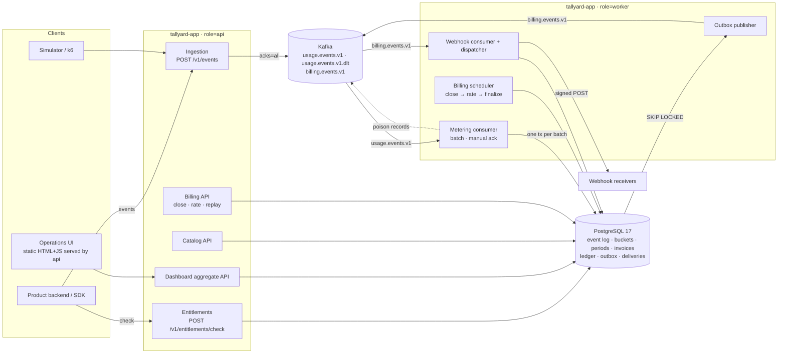
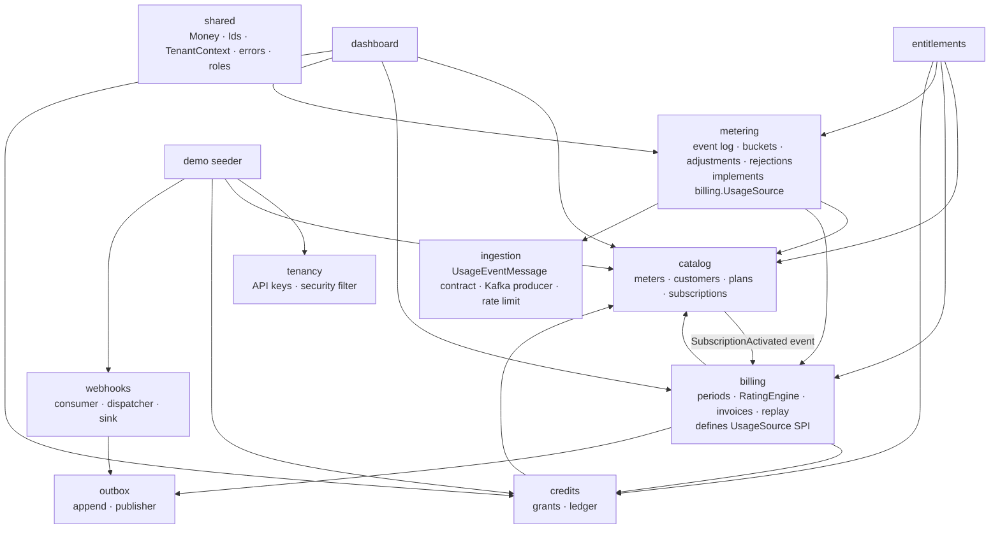
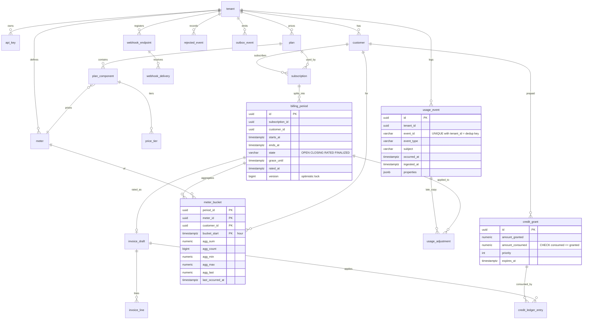
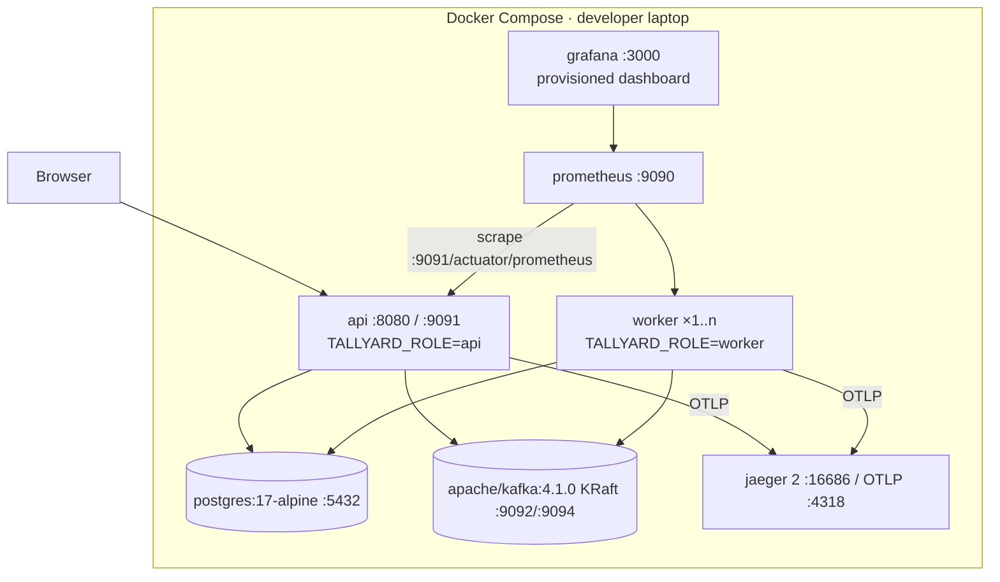

# Tallyard Architecture

*Every diagram below is derived from the implemented code (`tallyard-app`), and
the module structure is verified on every build by `ModularityTest`. Decisions are recorded in
[adr/](adr/); technology choices in [technology-decisions.md](technology-decisions.md); failure
behaviour in [failure-model.md](failure-model.md).*

## 1. System context (C4 level 1)



## 2. Containers (C4 level 2)

One artifact, two roles. `api` nodes serve HTTP; `worker` nodes consume Kafka and run schedulers.
Both talk to the same PostgreSQL. Kafka carries two topics.



## 3. Modules and dependencies (C4 level 3)

Each top-level package under `io.tallyard` is a Spring Modulith application module. Arrows are
compile-time dependencies on **public API types only** (root package); `internal` packages are
inaccessible across modules, and the graph is acyclic.



The cycle that *would* exist (billing needs quantities from metering; metering needs period state
from billing) is broken by dependency inversion: `billing` declares `UsageSource`, `metering`
implements it. Spring wires the implementation at runtime; the package graph stays acyclic.

## 4. Data flow — counting one event

```mermaid
sequenceDiagram
  autonumber
  participant C as Client SDK
  participant A as api · IngestController
  participant K as Kafka usage.events.v1
  participant W as worker · UsageEventConsumer
  participant M as MeteringService (one tx)
  participant P as PostgreSQL
  C->>A: POST /v1/events {events[1000]} + X-Api-Key
  A->>A: authenticate key · scope INGEST · token bucket
  A->>A: Bean Validation + future-skew check per event
  A->>K: send(key=tenant:subject, value=JSON, headers=schema v1) × N
  K-->>A: acks=all for every record
  A-->>C: 202 {accepted, invalid, results[]}
  K->>W: poll batch (≤500 records)
  W->>W: parse JSON; poison → DLT + SCHEMA_INVALID
  W->>M: process(messages)
  M->>P: INSERT usage_event … ON CONFLICT DO NOTHING RETURNING
  P-->>M: only newly inserted rows
  M->>P: SELECT billing_period … FOR SHARE (per subscription)
  M->>M: resolve meters, customer, subscription; extract values; fold per (period, meter, customer, hour)
  M->>P: INSERT meter_bucket … ON CONFLICT DO UPDATE (batched); UPDATE usage_event.period_id
  M->>P: INSERT usage_adjustment / rejected_event (batched)
  M->>P: COMMIT
  W->>K: acknowledge offsets
```

## 5. Event flow and contracts

| Topic | Key | Producer | Consumer group | Contract | Semantics |
|---|---|---|---|---|---|
| `usage.events.v1` | `tenantId:subject` | ingestion | `tallyard-metering` | `schemas/usage-event.v1.schema.json`, header `ty-schema-version: 1` | At-least-once; per-customer ordering; retention 7 d |
| `usage.events.v1.dlt` | original key | metering consumer | operators | original payload + `ty-dlt-reason`, `ty-dlt-source` | Unparseable records only |
| `billing.events.v1` | `aggregateId` | outbox publisher | `tallyard-webhooks` | `OutboxMessage` envelope; headers `ty-event-type`, `ty-event-id` | At-least-once; ordered per aggregate; consumers dedupe on event id |

Billing event types: `period.opened`, `period.closing`, `period.rated`, `period.finalized`,
`invoice.drafted`, `credit.depleted`.

```mermaid
flowchart LR
  rate[BillingService.rateLocked<br/>same transaction] -->|INSERT outbox_event| ob[(outbox_event)]
  ob -->|FOR UPDATE SKIP LOCKED| pub[OutboxPublisher]
  pub -->|send + wait acks| be[(billing.events.v1)]
  pub -->|UPDATE published_at| ob
  be --> bc[BillingEventsConsumer]
  bc -->|INSERT webhook_delivery<br/>UNIQUE(endpoint, event)| wd[(webhook_delivery)]
  wd -->|SKIP LOCKED| disp[WebhookDispatcher<br/>HMAC · backoff · breaker]
  disp -->|2xx| delivered[DELIVERED]
  disp -->|5xx / timeout| retry[PENDING · next_attempt_at]
  retry -->|attempts ≥ max| dead[DEAD]
```

## 6. Database (ERD)



Key indexes and constraints (from `V1__core_schema.sql`): `usage_event (tenant_id, event_id)`
unique; `usage_event (tenant_id, subject, occurred_at)` for replay; `billing_period_one_open`
partial unique index; `outbox_event_pending_idx` partial index on unpublished rows;
`webhook_delivery (endpoint_id, outbox_event_id)` unique; `credit_grant` check constraint.

## 7. Core workflow — closing and rating a period

```mermaid
sequenceDiagram
  autonumber
  participant S as BillingScheduler (worker)
  participant B as BillingService
  participant P as PostgreSQL
  participant U as UsageSource (metering)
  participant R as RatingEngine (pure)
  participant CR as CreditLedger
  participant O as Outbox
  S->>B: closeDue()
  B->>P: SELECT billing_period WHERE OPEN AND ends_at<=now FOR UPDATE SKIP LOCKED
  B->>P: state=CLOSING; flush; INSERT successor period (OPEN)
  B->>O: period.closing, period.opened
  S->>B: rateDue()
  B->>P: SELECT … WHERE CLOSING AND grace_until<=now FOR UPDATE SKIP LOCKED
  Note over B,P: FOR UPDATE waits for in-flight metering batches holding FOR SHARE
  B->>U: quantitiesFromBuckets(window, meters, now)
  B->>U: adjustments(periodId)
  B->>R: rate(plan, quantities, adjustments)
  R-->>B: lines, subtotal, hash
  B->>CR: apply(customer, subtotal, invoiceId)  (grants FOR UPDATE, expiry→priority order)
  B->>P: INSERT invoice_draft + lines; period.state=RATED (version+1)
  B->>O: period.rated, invoice.drafted, credit.depleted?
  B->>P: COMMIT
```

## 8. Deployment (local reference topology)



Production shape (not deployed here, documented in [failure-model.md](failure-model.md)): the same
image behind a load balancer for `api`, an autoscaled `worker` group sized by consumer lag, managed
PostgreSQL with a replica for dashboards, managed Kafka with replication factor 3.

## 9. Failure and recovery — worker crash during ingestion

```mermaid
sequenceDiagram
  autonumber
  participant SDK
  participant API as api
  participant K as Kafka
  participant W1 as worker (crashes)
  participant DB as PostgreSQL
  participant W2 as worker (restarted)
  SDK->>API: batches keep flowing
  API->>K: durable writes continue (202)
  K->>W1: batch n
  W1->>DB: tx: insert log, upsert buckets, COMMIT
  Note over W1: process killed before offset ack
  Note over K: consumer lag grows (visible in Grafana)
  W2->>K: join group, rebalance, resume from last committed offset
  K->>W2: batch n again (and n+1 …)
  W2->>DB: INSERT … ON CONFLICT DO NOTHING → 0 new rows for batch n
  W2->>K: ack; lag drains to zero
  Note over DB: totals identical to a crash-free run (simulator truth check)
```

## 10. Architecture review — questions and answers

| Question | Answer |
|---|---|
| Why is this service boundary necessary? | There is one deployable with two roles; module boundaries are compile-time. The only network boundaries are Kafka (durability + replay + backpressure) and PostgreSQL (truth). |
| What breaks if the worker disappears? | Ingestion keeps accepting (202); usage freezes; lag grows; periods are not rated; webhooks pause. Nothing is lost; everything resumes on restart. |
| Synchronous vs asynchronous | Sync: catalog, entitlement checks, period commands, dashboard. Async: counting, period lifecycle, outbox publishing, webhooks. |
| Source of truth per domain | PostgreSQL for everything billable; Kafka is a durable transport and replay buffer, not the system of record. |
| Kafka unavailable? | Ingest returns 503 + `Retry-After`; readiness drops `kafka`; all database-backed features continue. |
| PostgreSQL fails mid-processing? | Batch transaction rolls back; the error handler retries with backoff indefinitely; nothing is acked. API returns 5xx for DB-backed endpoints; readiness drops `db`. |
| Duplicate event? | Unique key → no-op; counted as `duplicate` in metrics. |
| Ordering? | Per customer via partition key; aggregates are commutative except LAST, which uses `occurred_at` (not arrival order). |
| Consumer restart? | Resume from committed offsets; redelivered batches are no-ops. |
| Workflow recovery? | Period state is a row; schedulers are stateless and idempotent (`SKIP LOCKED` + `@Version`). |
| Partial failure detection? | Metrics: lag, outbox backlog, webhook pending/dead, rejected by reason; traces across the pipeline. |
| Consistency? | Transactional within PostgreSQL; eventually consistent across Kafka hops; replay proves buckets == log. |
| What scales independently? | API nodes (requests) and workers (partitions); PostgreSQL is the shared ceiling. |
| Likely bottlenecks? | `usage_event` insert throughput (unique index), bucket upsert contention on hot customers, single-primary PostgreSQL. |
| Secrets? | API keys hashed; webhook secrets AES-GCM; encryption key and bootstrap token from environment; nothing in the repository. |
| Unnecessarily complex parts? | The demo webhook sink exists only for the local demo; the dashboard aggregate endpoint is convenience, not domain. Both are labelled as such. |
